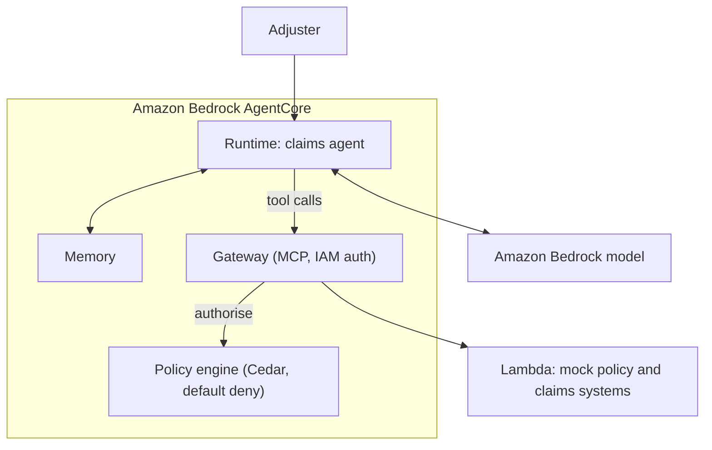

# AgentCore Claims Copilot

A claims adjudication copilot for a fictional property and casualty insurer, built on Amazon Bedrock AgentCore. An adjuster asks about a claim; the agent retrieves the records, applies the insurer's rules and explains a recommendation. A person makes the decision.

All data is synthetic. This is a portfolio project, not a production system.

## Why this project

Most agent demos are a model with a few tools. The hard parts of putting an agent into a regulated business are elsewhere: reaching systems of record safely, keeping money decisions reproducible, enforcing limits that hold even when the model is wrong or manipulated, and proving the agent does what it should. This repository is about those parts.

## Design in four decisions

1. **Rules decide, the model explains.** Coverage, payout, fraud indicators and approval routing are unit-tested Python. The model retrieves, orchestrates and explains. ([ADR 0001](docs/adr/0001-deterministic-adjudication.md))
2. **Legacy systems sit behind a Gateway.** The agent holds no data and reaches the insurer's systems through AgentCore Gateway with IAM-signed requests. ([ADR 0003](docs/adr/0003-gateway-in-front-of-legacy-systems.md))
3. **Hard limits live outside the agent.** A Cedar policy at the Gateway denies payout approvals above 10,000, whatever the model or the calling application says. ([ADR 0004](docs/adr/0004-approval-limit-enforced-at-the-gateway.md))
4. **Faithfulness is measured.** An evaluation set checks that each answer matches the rules, invents nothing and never claims a decision is final. ([evals/](evals/README.md))

## Architecture



Full walkthrough: [docs/ARCHITECTURE.md](docs/ARCHITECTURE.md).

## Status

| Area | State | Evidence |
|---|---|---|
| Adjudication rules | Done | 49 unit tests, run in CI on every push |
| Synthetic data and mock legacy systems | Done | [docs/DATA.md](docs/DATA.md) |
| Agent, run locally against Claude Sonnet 4.6 | Worked on two claims | [docs/BUILD_LOG.md](docs/BUILD_LOG.md), 14 Nov |
| Deployed to AgentCore Runtime, Memory, Gateway, Lambda | Deployed in us-east-2 | Build log, 14 Nov |
| Gateway to Lambda path | Verified live | Gateway returned real records over signed MCP calls |
| Policy at the Gateway | Verified live, 6 of 6 checks | `scripts/verify_policy.py`; 10,000 allowed, 10,001 denied |
| Evaluation harness | Built; catches a real defect from the first run | `evals/`, replay of saved transcripts |
| Live evaluation run | Blocked | The AWS account's Bedrock access was restricted at account level on 14 Nov; a support case is open |
| Deployed agent answering end to end | Blocked by the same restriction | [docs/INTERVIEW_NOTES.md](docs/INTERVIEW_NOTES.md), 1.9 |
| Adjuster user interface, observability dashboards, CI deploys | Not built | |

## Repository layout

```
app/agent/              The agent: prompt, tools, rules, Gateway client
  main.py               Entry point and system prompt
  tools/                The four tools the model can call
  domain/               Deterministic adjudication rules
  clients/              LegacyClient: Gateway and local implementations
services/legacy_api/    Mock policy and claims systems, packaged as a Lambda function
  data/                 Synthetic data and its generator
policies/               Cedar policies enforced at the Gateway
agentcore/              AgentCore project definition and CDK app
evals/                  Evaluation cases, scorers and runner
tests/                  Unit tests
scripts/                Setup, deploy, verification and teardown
docs/                   Architecture, decisions, build log, interview notes
```

## Run it

Requires Python 3.10+, [uv](https://docs.astral.sh/uv/) and, for anything touching AWS, Node.js 20+ and the AWS CLI.

**Tests (no AWS needed)**

```
uv run --no-project --with pytest python -m pytest tests -q
```

**Replay the evaluation on saved transcripts (no AWS needed)**

```
python -m evals.run_eval --replay evals/fixtures/first_local_run.json
```

This is expected to report failures: the saved transcripts are from before a prompt fix and contain the defect the scorers are meant to catch.

**Run the agent locally** (needs AWS credentials with Bedrock model access)

```
bash scripts/setup_local.sh     # one-time: tools and `aws login`
bash scripts/try_local.sh       # starts the agent and asks about two claims
```

**Deploy** (creates billable AWS resources in us-east-2)

From AWS CloudShell:

```
curl -fsSL https://raw.githubusercontent.com/sayush2807/agentcore-claims-copilot/main/scripts/deploy_cloudshell.sh | bash
```

or from a machine with a reliable upload connection: `bash scripts/deploy.sh`.

**Verify the Gateway policy** (after deploying, no model needed)

```
python3 scripts/verify_policy.py
```

**Evaluate the deployed agent**

```
python -m evals.run_eval --target deployed
```

**Tear down**

```
bash scripts/teardown.sh
```

## Documentation

| Document | Contents |
|---|---|
| [docs/ARCHITECTURE.md](docs/ARCHITECTURE.md) | Components, request flow, where each control lives |
| [docs/SUCCESS_CRITERIA.md](docs/SUCCESS_CRITERIA.md) | What "working" means, with targets and current evidence |
| [docs/DATA.md](docs/DATA.md) | How the synthetic data is generated and protected from leakage |
| [docs/adr/](docs/adr/) | Architecture decision records |
| [evals/README.md](evals/README.md) | Evaluation design, cases and known gaps |
| [policies/README.md](policies/README.md) | The Cedar policies |
| [docs/BUILD_LOG.md](docs/BUILD_LOG.md) | Chronological record of what was done and why |
| [docs/INTERVIEW_NOTES.md](docs/INTERVIEW_NOTES.md) | Issues hit, trade-offs, limitations and bias |

## Limitations

- The data is synthetic and far cleaner than real claims.
- The rules, the data and the tests were written by the same author.
- The fraud indicators are simple heuristics that would need fairness testing before any real use.
- The deployed agent has not yet answered end to end, and the evaluation has not run live, because of the account restriction noted above.

More detail in [docs/INTERVIEW_NOTES.md](docs/INTERVIEW_NOTES.md), section 3.
