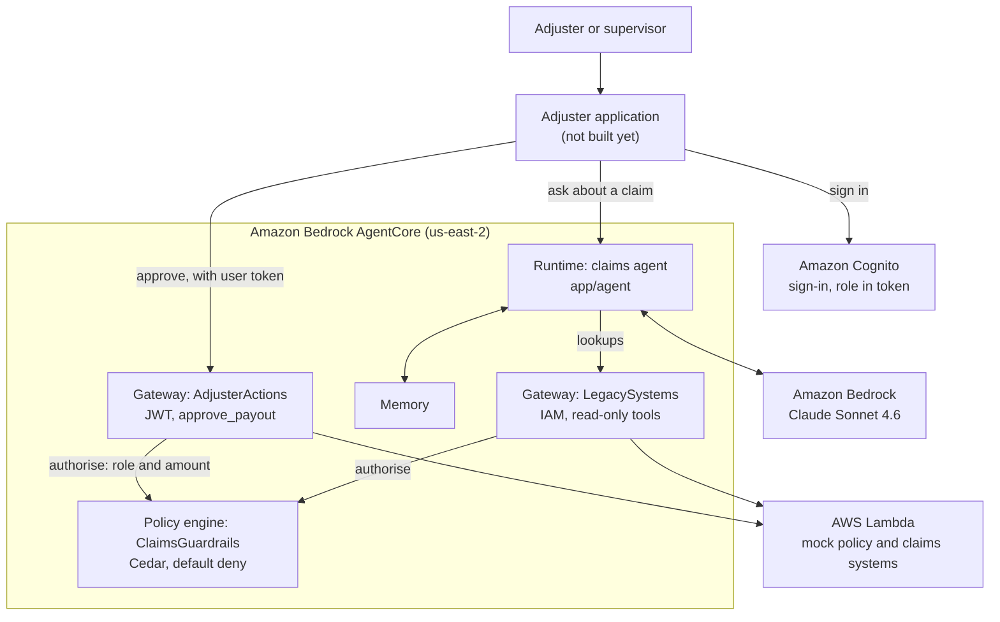

# Architecture

How the system is put together and how a request moves through it. Decisions and their reasons are in `adr/`; this document describes what exists.

## Components

| Component | What it is | Where it is defined |
|---|---|---|
| Claims agent | Python process using the Strands agent loop. Holds the system prompt, four tools and the adjudication rules | `app/agent/` |
| Runtime | AgentCore's managed host for the agent. Packages `app/agent` only | `agentcore/agentcore.json` (`runtimes`) |
| Memory | Managed store with semantic and episodic strategies | `agentcore/agentcore.json` (`memories`) |
| Gateway `LegacySystems` | Managed MCP endpoint for the agent. Read-only tools. Accepts only SigV4-signed requests from permitted IAM roles | `agentcore/agentcore.json` (`agentCoreGateways`) |
| Gateway `AdjusterActions` | Managed MCP endpoint for people. One tool, `approve_payout`. Accepts only tokens signed by the Cognito user pool | `agentcore/agentcore.json` (`agentCoreGateways`) |
| Identity | Cognito user pool; each user's role is a claim in their signed token | `infra/identity.yaml` |
| Policy engine | Evaluates Cedar policies on every Gateway tool call, in ENFORCE mode | `agentcore/agentcore.json` (`policyEngines`), `policies/*.cedar`, `agentcore/cdk/lib/cdk-stack.ts` |
| Legacy API | The same code deployed as one Lambda function per Gateway, standing in for the insurer's policy administration and core claims systems | `services/legacy_api/` |
| Infrastructure | A CDK app generated by the AgentCore CLI, extended to create the Cedar policies | `agentcore/cdk/` |

## How a claim review works

1. The adjuster sends a question, for example "Review claim CLM-9001".
2. The Runtime passes it to the agent. The agent loop sends the system prompt, the question and the descriptions of its four tools to the model.
3. The model does not run code. It replies with a request to call a tool. The prompt directs it to call `adjudicate_claim` first.
4. `adjudicate_claim` runs inside the agent process. It asks the `LegacyClient` for the claim, the policy and the claim history.
5. When deployed, `LegacyClient` is the Gateway implementation: each lookup is a SigV4-signed MCP `tools/call` request to the Gateway.
6. The Gateway asks the policy engine whether this caller may make this call with these inputs. Lookups are permitted.
7. The Gateway invokes the Lambda function, passing the tool name in the Lambda client context and the arguments as the event. The function reads the synthetic data and returns the record.
8. Back in the agent, the deterministic rules in `domain/adjudication.py` compute coverage, payout, fraud signals and the required approver.
9. The tool result goes back to the model, which may call the lookup tools for supporting detail and then writes the answer, ending with a structured `Summary:` line.

The model orchestrates and explains. It never decides coverage, computes money, or holds data.

## Where each control lives

| Concern | Control | Enforced by |
|---|---|---|
| Correct coverage and payout | Unit-tested Python rules | Code in the agent process (ADR 0001) |
| Who may call the legacy systems | IAM authorisation on the Gateway | AWS IAM (ADR 0003) |
| Who may approve a payout | Signed token from Cognito, checked before policy runs | JWT authorizer on the `AdjusterActions` Gateway (ADR 0005) |
| How much each role may approve | Cedar policies on role and amount, default deny | AgentCore Policy (ADR 0004, 0005) |
| Agent cannot approve or pay | The agent has no such tool, its Gateway does not expose one, and it holds no user token | Tool list, Gateway definition, and the authorizer |
| Instructions hidden in claim text | Prompt rule, plus the outcome is computed by rules, not by the model | Prompt and code; measured by the evaluation set |
| Answer faithfulness | Evaluation gate comparing answers with rule output | `evals/` |

## How an approval works

1. A person signs in through Cognito and receives a signed ID token containing their role.
2. The adjuster application calls `approve_payout` on the `AdjusterActions` Gateway with that token.
3. The Gateway verifies the token's signature, issuer and audience. A missing or unsigned token is rejected with HTTP 401 before anything else happens.
4. The policy engine evaluates the call: the role from the token and the amount from the request. No matching permit means denied.
5. Only then is the Lambda function invoked. It records the approval and does not re-check the limit.

The agent is not part of this path.

## Local versus deployed

The agent's tools depend on an interface, `LegacyClient`, with two implementations:

- **Deployed:** `GatewayLegacyClient`, selected when AgentCore has set `AGENTCORE_GATEWAY_LEGACYSYSTEMS_URL` on the runtime.
- **Local and tests:** `LocalLegacyClient`, which imports the mock systems from `services/legacy_api` directly.

A unit test asserts both return identical records, so local behaviour predicts deployed behaviour for everything except network and authorisation.

## Deployment

Two CloudFormation stacks. `ClaimsCopilot-Identity` (from `infra/identity.yaml`) is deployed first; `scripts/configure_identity.sh` writes its discovery URL and client ID into the working copy of `agentcore/agentcore.json`. Then `agentcore deploy` synthesises and deploys `AgentCore-ClaimsCopilot-default` from that file. The CDK stack reads each file in `policies/`, substitutes the named Gateway's ARN and creates it as a policy validated against the Gateway's tool schema.

Deploys currently run from AWS CloudShell (`scripts/deploy_cloudshell.sh`); see `INTERVIEW_NOTES.md` 1.7 for why.

## Not built yet

- A user interface for adjusters.
- AgentCore Observability dashboards and online evaluations.
- Deployment from CI with short-lived credentials.
